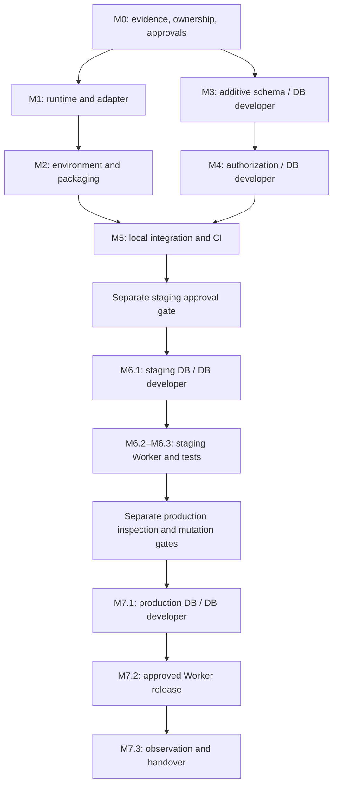

# Vercel deployment roadmap

**Active owner decision, 2026-11-02: Vercel is the active and final hosting target; Cloudflare migration is discontinued.** Cloudflare-specific deployment tasks are **SUPERSEDED**, not completed. The old M0–M7 execution sequence is archived below and must not be resumed as the current release plan. Original task files and historical validation results are unchanged.

## Disposition of the original plan

| Historical scope | Current disposition |
| --- | --- |
| M0 evidence/ownership and M1 runtime/local migration checks | Keep dated observations and actual prior outcomes. Cloudflare target/recovery requirements and the Cloudflare adapter choice are SUPERSEDED; relevant ownership and database recovery gaps still require Vercel-specific assessment. |
| M2.1–M2.3 environment/Workers packaging | SUPERSEDED as the Cloudflare execution package, not completed. Target-specific public environment validation and Vercel artifact checks are carried into the gates below without claiming M2 completion. |
| M3/M4 database compatibility/authorization | Historical proposals; not implemented or authorized by the hosting decision. Any real compatibility/security issue needs owner/database-developer resolution before release. |
| M5.1 local Workers tests; Cloudflare-specific parts of M5.2/M5.3 | SUPERSEDED, not completed. Relevant clean-install, UI, security and release evidence requirements carry forward to Vercel. |
| M6.2 staging Worker/10013 diagnosis; Cloudflare-specific parts of M6.1/M6.3 | SUPERSEDED, not completed. Preview verification replaces the hosting release path; database access/tests remain separately scoped. |
| M7.2 production Worker release; Cloudflare-specific parts of M7.1/M7.3 | SUPERSEDED, not completed. Production uses the Vercel gate below. Database/recovery, observation and handover requirements are retained where applicable. |

Historical task statuses have not been rewritten. Do not convert cancellation into DONE or use the old 24-task totals as current Vercel progress.

## Active gate sequence

| Gate | Required evidence | Current status |
| --- | --- | --- |
| Local preparation | Astro `7.4.4` / Vercel adapter `11.0.17`, Node `22.23.4` / npm `10.9.9`, scoped overrides, consistent lockfile, clean installation/tree/check/build/audit, SSR/admin artifacts | VERIFIED LOCALLY in prior work; audit 0; existing unused-import hint retained; dummy Supabase inputs only |
| Pre-commit review | Secret-safe exact stage list; ignored environment/generated/temporary files; retained history clearly distinguished from active Vercel instructions | PENDING re-review after this documentation correction; no staging/publication authorized |
| Preview preparation | Confirm Vercel project/team/owner, repository/root and intended Preview branch/trigger, preset Astro, Node 22.x, install `npm ci`, build `npm run build`, adapter-managed output, approved isolated Supabase public inputs | PENDING; remote settings not independently verified |
| Preview release and acceptance | Explicit Preview release authorization; fresh target-specific build; routes/assets, SSR freshness, browser errors, login/logout, CRUD/uploads and intended authorization checked against approved disposable fixtures; private server files not served; actual deployment identity/results recorded | PENDING; no Preview deployed or live tests claimed |
| Production readiness | Accepted Preview; confirmed Production branch (historically reported `main`, re-confirm), project/domain/DNS ownership, approved production inputs, current schema/security compatibility sign-off and database/Auth/Storage recovery evidence, known-good Vercel recovery candidate or reviewed initial-release recovery procedure, monitoring thresholds/duration | PENDING; database backup/restore and domain activation unverified |
| Production release and handover | Separate Production and any DNS authorization; rebuild for Production inputs, inspect candidate before promotion, execute approved recovery/observation plan, verify public/admin behavior, record deployment/domain/artifact identities and owners | PENDING; no production action authorized or performed |

Follow [RUNBOOK](RUNBOOK.md) and [DECISIONS](DECISIONS.md). Publication, Preview, Production and any database operations retain separate authorization boundaries. Missing target isolation, compatibility, security or recovery evidence blocks the affected release gate. A passing build/audit does not establish live Supabase behavior or a safe release.

## Historical archive — SUPERSEDED Cloudflare execution plan

**Historical record only.** The entire disclosure below preserves the previous document verbatim. Its commands, task states, version choices and approval assessments apply to their original dates. Cloudflare-specific deployment tasks are **SUPERSEDED**, not completed; do not execute the archived plan. Unchanged linked milestone/task/evidence files and original logs have the same historical status for hosting. The current Vercel section above takes precedence. Supabase proposals remain subject to separate review and authorization.

<details>
<summary>Preserved historical Cloudflare records — not active instructions</summary>

# Deployment remediation roadmap

Planning snapshot: 2026-10-30. **8 milestones, 24 tasks: M0.1/M1.1/M1.2/M1.3 DONE, M0.2/M0.3 BLOCKED, 18 NOT_STARTED.** M0.2 has partial management/settings/access confirmation but still lacks target separation, remaining role assignments and recoverable Worker/database evidence. Historical 10013 remains unresolved; unavailable metadata explicit. M0.3 documentation prepared; M1.1 runtime verified under explicit local-only exception on 2026-11-01. M1.2 subsequently resumed with approved Astro 7 candidates and is DONE after local migration/check/build and clean audits; B-M1.2-01 resolved for those migrated versions. M1.3 now DONE after explicit local clean-install/compatibility/static/audit verification; M1’s three local tasks complete. Stop before M2; no deployment.

## Milestones

| Milestone | Outcome area | Workstream | Tasks | Status |
| --- | --- | --- | --- | --- |
| [M0](milestones/M0.md) | Evidence, ownership, and authorization | Governance | M0.1–M0.3 | BLOCKED (M0.2/M0.3); 1/3 complete |
| [M1](milestones/M1.md) | Runtime and Astro adapter | Infrastructure | M1.1–M1.3 | DONE: M1.1–M1.3; 3/3 local tasks verified |
| [M2](milestones/M2.md) | Environment and Workers packaging | Infrastructure | M2.1–M2.3 | NOT_STARTED |
| [M3](milestones/M3.md) | Supabase schema compatibility | Database | M3.1–M3.3 | NOT_STARTED |
| [M4](milestones/M4.md) | Supabase authorization and Storage | Database / security | M4.1–M4.3 | NOT_STARTED |
| [M5](milestones/M5.md) | Local integration and deterministic CI | Infrastructure / integration | M5.1–M5.3 | NOT_STARTED |
| [M6](milestones/M6.md) | Approved staging and error 10013 diagnosis | Staging: separate DB and infrastructure tasks | M6.1–M6.3 | NOT_STARTED |
| [M7](milestones/M7.md) | Approved production rollout and handover | Production: separate DB and infrastructure tasks | M7.1–M7.3 | NOT_STARTED |

## Task inventory and direct dependencies

| Task | Objective | Required predecessor tasks | Status |
| --- | --- | --- | --- |
| [M0.1](tasks/M0.1.md) | Capture baseline and sanitized failure evidence | None | DONE |
| [M0.2](tasks/M0.2.md) | Record resource ownership and recovery targets | M0.1 | BLOCKED: B-M0.2-01 / B-M0.2-02 |
| [M0.3](tasks/M0.3.md) | Approve scope and workstream handoffs | M0.2 | BLOCKED: preparation complete; M0.2 and B-M0.3-01 approvals pending |
| [M1.1](tasks/M1.1.md) | Verify and pin the local runtime | M0.3; explicit M1.1 local-only exception | DONE |
| [M1.2](tasks/M1.2.md) | Migrate adapter and generate reviewed lockfile | M1.1 | DONE: approved Astro 7 migration and local validation |
| [M1.3](tasks/M1.3.md) | Verify reproducible install and static checking | M1.2 | DONE: isolated clean install/static check/audit |
| [M2.1](tasks/M2.1.md) | Define explicit Worker configuration and bindings | M1.3, M0.2 | NOT_STARTED |
| [M2.2](tasks/M2.2.md) | Implement the build-time environment contract | M2.1 | NOT_STARTED |
| [M2.3](tasks/M2.3.md) | Verify asset exclusions and deterministic build outputs | M2.2 | NOT_STARTED |
| [M3.1](tasks/M3.1.md) | Agree database contract and isolated test harness | M0.3 | NOT_STARTED |
| [M3.2](tasks/M3.2.md) | Implement additive content compatibility migration | M3.1 | NOT_STARTED |
| [M3.3](tasks/M3.3.md) | Prove preservation and migration replay behavior | M3.2 | NOT_STARTED |
| [M4.1](tasks/M4.1.md) | Create trusted administrator membership boundary | M3.3 | NOT_STARTED |
| [M4.2](tasks/M4.2.md) | Replace content and Storage mutation policies atomically | M4.1 | NOT_STARTED |
| [M4.3](tasks/M4.3.md) | Verify authorization through real Data and Storage APIs | M4.2 | NOT_STARTED |
| [M5.1](tasks/M5.1.md) | Verify local Workers behavior and UI parity | M2.3, M4.3 | NOT_STARTED |
| [M5.2](tasks/M5.2.md) | Prepare one deterministic validation pipeline | M5.1 | NOT_STARTED |
| [M5.3](tasks/M5.3.md) | Assemble staging candidate and approval gate | M5.2, M3.3, M4.3 | NOT_STARTED |
| [M6.1](tasks/M6.1.md) | Prepare staging database through database developer | M5.3 | NOT_STARTED |
| [M6.2](tasks/M6.2.md) | Deploy staging Worker and classify error 10013 | M6.1 | NOT_STARTED |
| [M6.3](tasks/M6.3.md) | Verify staging parity, authorization and recovery | M6.2 | NOT_STARTED |
| [M7.1](tasks/M7.1.md) | Approve production inspection and database-first rollout | M6.3 | NOT_STARTED |
| [M7.2](tasks/M7.2.md) | Release approved production Worker | M7.1 | NOT_STARTED |
| [M7.3](tasks/M7.3.md) | Monitor service acceptance and hand over | M7.2 | NOT_STARTED |

## Dependency-aware execution order

After a new instruction to begin and the relevant approval gates, this is one valid serial topological order:

```text
M0.1 → M0.2 → M0.3
M1.1 → M1.2 → M1.3 → M2.1 → M2.2 → M2.3
M3.1 → M3.2 → M3.3 → M4.1 → M4.2 → M4.3
M5.1 → M5.2 → M5.3
M6.1 → M6.2 → M6.3
M7.1 → M7.2 → M7.3
```

Documentation-only M0.3 scope/handoff preparation was explicitly authorized and completed while M0.2 is blocked; see [draft scope and approval checklist](evidence/approvals.md). The recorded M0.2 predecessor still gates formal M0.3 completion and downstream work unless explicitly revised. M0.3 is BLOCKED by M0.2 and missing scope/design/handoff approvals; the subsequent user instruction grants an exception for M1.1 only. Node 22.23.4/npm 10.9.9 were verified; no other predecessor or approval gate is waived. Safest next task: collect remaining M0.2 owner/target and recovery evidence; Supabase Developer access does not verify backup/restore authority or capability.

After M0.3, infrastructure M1→M2 and database M3→M4 can proceed independently under their own owners and permissions. This describes a future scheduling option, not an instruction to start implementation or agents. M5.1 joins both streams, requiring M2.3 AND M4.3. M5.3 checks the schema/security sign-offs again. The database developer prepares staging in M6.1 before the staging Worker deploy in M6.2. M7.1 completes separately approved production inspection and database work before the production Worker release M7.2.



## Blockers and gate requirements

| Gate | Evidence / owner required | Current state |
| --- | --- | --- |
| Begin M0.1 | New instruction to start execution | Authorized by user's M0.1 request; baseline collected |
| Complete M0.1 | Reviewed baseline and owner-supplied incident evidence, explicit unknowns/owners | DONE; B-M0.1-01 resolved; unavailable status/correlation metadata recorded |
| Complete M0.2 | Owner-confirmed resource separation/roles/current CI and Worker/database recovery evidence | BLOCKED: B-M0.2-01 / B-M0.2-02; unknown recovery capability blocks production |
| Local implementation | G1-R repository files/design; G1-I install/tooling; G1-B local builds/tests; G1-D isolated SQL/Auth/Storage tests; user / DB developer | M1.1-only local scope/runtime installation and validation granted and verified; all other scopes PENDING; M0.3 BLOCKED |
| Database design | Actual schema/history, array/backfill agreement, allowlist owner/admin enrollment; DB developer | Live state unknown; pending |
| Local integration | Accepted dependency, schema, RLS, packaging and parity tests | Not run |
| CI | One release owner, actual commands/runtime/triggers, protected target inputs | Production main, npm run build and npx wrangler deploy confirmed; provider/install/runtime/root/trigger details pending |
| Staging | M5.3 manifest and distinct project/Worker/KV; separate DB and Cloudflare approvals | Pending |
| Error 10013 diagnosis | Historical stage/message/times/commands/version/count documented; preserve missing metadata for later diagnosis | Root cause unknown; HTTP status/correlation identifier unavailable; not an M0.1 blocker |
| Production | Verified staging, approved inspection, no unresolved drift, backup/recovery and separate DB/Worker permissions | Pending |
| Completion | Required observation and signed actual evidence for every task marked complete | Not run |

Database developer coordination is mandatory for M3/M4, M6.1/M7.1, and any integration/release database or Storage mutation checks. Failed validation, missing permission or unknown target stops the affected workstream. Isolated upload success or a dependency check cannot count as end-to-end acceptance.

## Evidence and status control

If infrastructure and database work are scheduled concurrently, serialize shared edits to package.json/package-lock.json and preserve the other owner's changes. Database test scripts must not cause unrelated dependency resolution. Candidate manifests and CI checks must include the final combined state before M5 acceptance.

Evidence files belong under docs/deployment/evidence/. M0.1 contains actual local diagnostics and attributed historical evidence; M0.2 [targets](evidence/targets.md) and [recovery](evidence/recovery.md) record local identity plus 2026-11-01 user-confirmed management/settings/Supabase Developer access and selected domain. Backup/restore remain UNVERIFIED, domain activation UNCONFIRMED, and remaining target/recovery evidence missing. M0.3 [scope/approval evidence](evidence/approvals.md) is prepared documentation with pending implementation approvals. M1.1 [runtime evidence](evidence/runtime.md) records actual execution under the local exception. M1.2 [execution evidence](tasks/M1.2.md) preserves the security stop and subsequent approved Astro 7 migration, clean audits, successful check/build and necessary syntax correction; M1.3 [dependency-validation evidence](evidence/dependency-validation.md) records fresh default npm ci, valid required tree, reviewed locked optional annotation, zero audit findings and unchanged inputs. M2 onward evidence remains proposed. Never create fictitious execution results. Record sanitized commands/exits, applicable assertions, artifact/config/schema identity, UTC timestamp, approval reference and reviewer.

NOT_STARTED becomes IN_PROGRESS only after authorization and actual work. BLOCKED requires a stated blocker, owner and next action. DONE requires actual acceptance verification; reopen impacted tasks when input/config/schema changes invalidate evidence. Preserve history and original documents. Record deviations in DECISIONS/CHANGELOG. Commit, push, merge and scope expansion need separate instructions.


</details>
