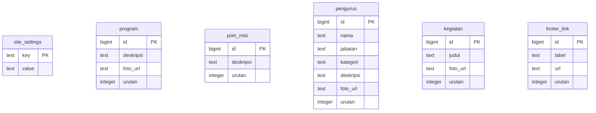

Database analysis of the repository at `82ca4b807f8dc337205c48ae3bb5c703f172edfe`, reviewed on 2026-10-27.

**Scope and evidence boundary.** This report describes repository-defined SQL and application expectations, not the actual live Supabase database. No database connection, SQL execution, package installation, build, deployment, or credential inspection was performed. The only authorized write is this report. Existing documentation and application files were left unchanged.

All files under `supabase/`, including hidden/ignored paths, were inventoried. The only file is [`supabase/schema.sql`](../../supabase/schema.sql), read in full (178 lines). There is no repository migration directory, migration SQL, Supabase configuration file, or recorded migration history under that directory. The SQL assumes a pre-existing Supabase installation, including managed Auth and Storage schemas.

Structural application checks used the codebase-memory graph, generation `2026-10-27T12:24:01Z`, followed by direct source verification. Coverage was checked for all 13 relied-on SQL/application paths and the `src/` and `supabase/` scopes. The graph reported partial SQL parsing; the entire SQL source, including every reported gap, was read directly. Conclusions about SQL completeness rely on that filesystem inventory and source, not graph absence alone.

**Main findings**

| Priority | Confirmed repository finding | Consequence if the live database matches this SQL |
| --- | --- | --- |
| High | `prestasi` is queried and editable but has no table definition, grants, or RLS policies in the script. | Homepage SSR and the admin dashboard/list can fail on missing-relation/API errors. |
| High | SQL has `program.foto_url text`; application reads/writes `program.foto_urls` as an array. | Existing single-image values are not used by the slider; admin saves referencing the missing column fail. |
| High | Content writes are authorized for every `authenticated` user, without an admin predicate. | Any signed-in account can mutate all six content tables through the Data API. |
| High | Photo write policies check only the `foto` bucket and authentication. | No admin, owner, or folder restriction on permitted photo mutations. Actual deletion/update also depends on required SELECT access. |
| High operational risk | The script drops eight named tables with `CASCADE` and recreates only six. | Re-running can destroy content and dependent database objects. |
| Medium | No `storage.objects` SELECT policy is defined. | Authenticated Storage delete/update operations may be blocked despite their mutation policies. |
| Medium | Schema-wide grants apply to all existing public tables. | Unrelated existing tables may receive access, with exposure depending on their RLS and other privileges. |

These findings do not prove that any issue exists in production: manually applied schema, policies, grants, and configuration may differ.

**Complete application table and column inventory**

SQL `int` means PostgreSQL `integer` (int4), `bigint` means int8. “Nullable” is taken from the DDL. PK columns are implicitly NOT NULL. Nullable columns without an explicit default default to NULL; required columns without a default require a value unless generated.

| Table | Column | SQL type | Nullable | Default/generation | Keys and constraints |
| --- | --- | --- | --- | --- | --- |
| `public.site_settings` | `key` | `text` | No | None | Primary key |
| `public.site_settings` | `value` | `text` | No | `''` | NOT NULL |
| `public.program` | `id` | `bigint` | No | GENERATED ALWAYS AS IDENTITY | Primary key |
| `public.program` | `deskripsi` | `text` | No | None | NOT NULL |
| `public.program` | `foto_url` | `text` | Yes | No explicit default | None |
| `public.program` | `urutan` | `integer` | No | `0` | NOT NULL |
| `public.poin_misi` | `id` | `bigint` | No | GENERATED ALWAYS AS IDENTITY | Primary key |
| `public.poin_misi` | `deskripsi` | `text` | No | None | NOT NULL |
| `public.poin_misi` | `urutan` | `integer` | No | `0` | NOT NULL |
| `public.pengurus` | `id` | `bigint` | No | GENERATED ALWAYS AS IDENTITY | Primary key |
| `public.pengurus` | `nama` | `text` | No | None | NOT NULL |
| `public.pengurus` | `jabatan` | `text` | No | None | NOT NULL |
| `public.pengurus` | `kategori` | `text` | No | `'pengurus'` | CHECK: `kategori IN ('pengurus','pengajar')` |
| `public.pengurus` | `deskripsi` | `text` | Yes | No explicit default | None |
| `public.pengurus` | `foto_url` | `text` | Yes | No explicit default | None |
| `public.pengurus` | `urutan` | `integer` | No | `0` | NOT NULL |
| `public.kegiatan` | `id` | `bigint` | No | GENERATED ALWAYS AS IDENTITY | Primary key |
| `public.kegiatan` | `judul` | `text` | No | None | NOT NULL |
| `public.kegiatan` | `foto_url` | `text` | Yes | No explicit default | None |
| `public.kegiatan` | `urutan` | `integer` | No | `0` | NOT NULL |
| `public.footer_link` | `id` | `bigint` | No | GENERATED ALWAYS AS IDENTITY | Primary key |
| `public.footer_link` | `label` | `text` | No | None | NOT NULL |
| `public.footer_link` | `url` | `text` | No | `'/'` | NOT NULL |
| `public.footer_link` | `urutan` | `integer` | No | `0` | NOT NULL |

Total: **6 tables, 24 columns, 6 primary keys, 5 identity columns, and 1 explicit CHECK expression**. There are 20 non-nullable columns, including the PK/identity columns, and 4 nullable columns. The script does not explicitly name constraints.

Definitions are at `schema.sql:13` (settings), `:19` (program), `:27` (mission points), `:34` (people), `:45` (gallery), and `:53` (footer links).

**Keys, indexes, other objects, and relationships**

| Table | PK / implied unique B-tree index | Other repository-defined indexes |
| --- | --- | --- |
| `site_settings` | `(key)`; normally named `site_settings_pkey` | None |
| `program` | `(id)`; normally `program_pkey` | None |
| `poin_misi` | `(id)`; normally `poin_misi_pkey` | None |
| `pengurus` | `(id)`; normally `pengurus_pkey` | None |
| `kegiatan` | `(id)`; normally `kegiatan_pkey` | None |
| `footer_link` | `(id)`; normally `footer_link_pkey` | None |

The index names above are PostgreSQL's expected generated names in a clean schema, not inspected live names. Primary keys imply unique indexes; no `CREATE INDEX`, separate UNIQUE constraint, exclusion constraint, composite key, or foreign key appears. Each identity column implies a supporting sequence; no sequence is explicitly created or customized. PostgreSQL documents [PK/index behavior](https://www.postgresql.org/docs/current/ddl-constraints.html) and [identity sequences](https://www.postgresql.org/docs/current/ddl-identity-columns.html).

There are no table-to-table relational links, joins, database views, persistent functions, triggers, custom enums, ownership columns, timestamps, publication status, or soft-delete columns defined by this SQL. The `DO` block is an anonymous policy-creation block, not a stored function. The category is a text CHECK, not a PostgreSQL enum or FK.

Photo URLs in `program`, `pengurus`, `kegiatan`, and settings values are application-level references to files, not FKs to `storage.objects`. Deleting a database row does not trigger file deletion; the browser performs separate cleanup. No content row references an Auth user. `urutan` is non-unique and may be negative or repeated; category-specific ordering is enforced only by application behavior.

`public.statistik` and `public.nilai` occur only in the DROP list at `schema.sql:7–8`. No columns, keys, indexes, relationships, policies, or new definitions for these names exist in the repository. Do not classify them as defined tables. `prestasi` is likewise not created, but is an application dependency.

**Repository-defined ERD**

Only the six application tables created by the SQL are shown. There are deliberately no relationship edges because the repository defines no foreign keys. PK denotes primary key; defaults, nullability, and the category CHECK are detailed in the inventory above.

The missing `prestasi` table, missing `program.foto_urls` column, and Supabase-managed tables are excluded to avoid presenting inferred or external structures as repository DDL.

**Supabase-managed objects referenced by the script**

| Object | Repository interaction | What is not defined here |
| --- | --- | --- |
| `storage.buckets` | Inserts `(id, name, public) = ('foto', 'foto', true)` with `ON CONFLICT (id) DO NOTHING`. | Column types, full column list, PK/FKs/indexes, grants, and underlying table DDL. |
| `storage.objects` | Creates three mutation policies referencing `bucket_id`. | Column types, PK/FKs/indexes, full DDL, SELECT policies, and explicit RLS enablement/grants. |
| Supabase Auth | Browser uses password login, session retrieval, sign-out, and auth-state changes. | Auth schema DDL, users, provider/signup settings, and any administrator identity. |

The conflict clause assumes an existing unique/PK conflict target on bucket `id`; it does not define that constraint. Existing `foto` bucket attributes are not updated on conflict: if the bucket is already private, this script does not make it public. No file-size or MIME restriction is configured by this insert. Managed Storage/Auth relationships must be obtained from a separately authorized schema export before being included in a live ERD.

**RLS and grants**

The loop at `schema.sql:66–75` enables RLS on each of `site_settings`, `program`, `poin_misi`, `pengurus`, `kegiatan`, and `footer_link` and adds both of the following policies to each table: **12 content policies total**.

| Policy | Command | Roles | USING | WITH CHECK | Effect |
| --- | --- | --- | --- | --- | --- |
| `publik baca` | SELECT | `anon`, `authenticated` | `true` | Not specified | All rows readable. |
| `admin tulis` | ALL | `authenticated` | `true` | `true` | All rows readable/insertable/updatable/deletable by signed-in users, subject to SQL privileges. |

The word `admin` is only a policy name. There is no `auth.uid()`, membership lookup, trusted role claim, owner comparison, or authorization function. The script's instruction to disable signup is a comment, not enforced SQL or evidence of actual Auth settings. Even disabled signup does not distinguish an ordinary existing account from an administrator.

The content RLS is not forced with `FORCE ROW LEVEL SECURITY`. Trusted owners and bypass-RLS/service roles need separate consideration; normal API roles remain governed by RLS. Policies default to permissive, so adding a narrower permissive policy without removing the broad one does not close the broad access path. These interpretations follow [Supabase's RLS documentation](https://supabase.com/docs/guides/database/postgres/row-level-security).

The grants at `schema.sql:78–80` are:

- Schema `public`: USAGE to `anon` and `authenticated`.
- All currently existing tables in `public`: SELECT to both roles.
- All currently existing tables in `public`: INSERT, UPDATE, DELETE to `authenticated`.

These are wider than the six-table list. They do not enable RLS on other tables, do not grant future-table privileges through `ALTER DEFAULT PRIVILEGES`, and do not revoke pre-existing privileges. No explicit sequence grants are present; do not infer a runtime identity-insert failure merely from this absence. Managed defaults, identity behavior, and actual privileges were not inspected. No TRUNCATE/DDL grant is added by these statements; table RLS should not be treated as protection against privileged schema execution.

Storage policies at `schema.sql:90–99` are dropped/recreated by name and apply to `storage.objects`: **3 storage policies, 15 created policies overall**.

| Policy | Command | Role | USING | WITH CHECK |
| --- | --- | --- | --- | --- |
| `foto admin upload` | INSERT | `authenticated` | Not specified | `bucket_id = 'foto'` |
| `foto admin ubah` | UPDATE | `authenticated` | `bucket_id = 'foto'` | `bucket_id = 'foto'` |
| `foto admin hapus` | DELETE | `authenticated` | `bucket_id = 'foto'` | Not specified |

No owner, folder, or administrator condition appears. Other existing storage policies are untouched. The script assumes Supabase-managed RLS/grants on Storage rather than defining them.

Public bucket delivery allows URL-based image retrieval; it does not automatically grant authenticated object listing or all mutation permissions. Storage deletion requires SELECT and DELETE access, while update/overwrite also needs relevant SELECT access. Because this file adds no Storage SELECT policy, existing policies may be necessary for these operations. This is a **repository completeness risk**, not a verified live failure. See [public bucket semantics](https://supabase.com/docs/guides/storage/buckets/fundamentals), [Storage access control](https://supabase.com/docs/guides/storage/security/access-control), and [remove operation permissions](https://supabase.com/docs/reference/javascript/storage-from-remove).

**Application query comparison**

[`src/lib/supabase.ts`](../../src/lib/supabase.ts) creates browser and server clients using the public URL/key variable names. The server client disables persisted sessions and token refresh; public SSR therefore relies on anonymous-readable data under the intended public-key configuration. No service-role variable or privileged server-write path appears in the reviewed client module. Actual environment values were not inspected.

| Table | Public read path (`src/lib/data.ts`) | Browser admin usage (`src/scripts/admin.ts`) | Schema match |
| --- | --- | --- | --- |
| `site_settings` | `getSettings`, line 26: select `key,value`, map keys to a record. | Branding before login, settings/dashboard reads, and upsert `{key,value}` at line 1360. | Both columns and key-based upsert match. Arbitrary new setting keys are permitted. |
| `program` | `getProgram`, line 30: select all, order `urutan`; homepage consumes `foto_urls`. | Config at line 172; writes `deskripsi`, `foto_urls` array, `urutan`; generic CRUD/reordering. | `foto_urls` missing; `foto_url` SQL column is not the field used by this UI. |
| `poin_misi` | `getPoinMisi`, line 33: select all, order `urutan`. | Config at line 178; writes `deskripsi`, `urutan`; generic CRUD/reordering. | Match. |
| `pengurus` | `getPengurus`, line 36: select all, order `urutan`; optional category filter. Current page loads all and groups in memory. | Config at line 202; writes `nama`, `jabatan`, `kategori`, `urutan`; generic CRUD/reordering. | Match; nullable `deskripsi`/`foto_url` are read publicly but lack editing fields in the current list configuration. |
| `kegiatan` | `getKegiatan`, line 41: select all, order `urutan`; optional limit. | Config at line 188; writes `judul`, `foto_url`, `urutan`; generic CRUD/reordering and image cleanup. | Match. |
| `footer_link` | `getFooterLinks`, line 46: select all, order `urutan`. | Not present in current `LISTS`. | Columns match, but no current call site for this getter or table editor was found in `src/`; footer component does not consume it. |
| `prestasi` | `getPrestasi`, line 15: select all, order `urutan`. | Config at line 184: `deskripsi`, `urutan`; generic CRUD/reordering. | Table missing. Expected interface is `{id:number, deskripsi:string, urutan:number}`; SQL types/constraints are not defined. |

Admin list configurations are all within `src/scripts/admin.ts:170–215`; exact entry locations should be read from that source if code moves. Generic paths: dashboard selects each configured table at line 915; `fetchRows` orders by `urutan,id` at line 1101; `submitRow` inserts/updates at lines 1435–1437; `deleteRow` deletes by `id` at line 1473; `moveRow` updates `urutan` by `id` at line 1523. Settings upsert relies on the existing `key` PK and the public SELECT policy required for returning/seeing rows. Inserts omit generated IDs, consistent with GENERATED ALWAYS identities.

No SQL joins, embedded FK relationship selects, or database RPC calls were found in the application source. The dynamic `cfg.table`/`l.table` queries were checked against all five configured list tables: program, poin_misi, prestasi, kegiatan, pengurus.

Route impact:

- `/`: settings, program, mission points, gallery, and achievements. `src/pages/index.astro:19` awaits `getPrestasi`; `must()` at `src/lib/data.ts:21` throws on errors. If the table is absent, homepage SSR has no local fallback for that failure.
- `/galeri`: settings and gallery (`src/pages/galeri.astro:6`).
- `/pengurus`: settings and people (`src/pages/pengurus.astro:5`), grouped by category in application code.
- `/admin`: prerendered shell (`src/pages/admin/index.astro:7`), database/Auth/Storage operations run in the browser. Login success or a stored session opens the shell without an admin membership check (`submitLogin` and startup at `src/scripts/admin.ts:1825`). Database policies must provide authorization independently of UI visibility.

For program images, `SELECT *` itself can succeed without `foto_urls`; the homepage guard at `src/pages/index.astro:115` then omits images. If a manually added `foto_urls` is a nonempty string rather than an array, `.map()` can fail. The admin `imageUrls()` normalizer accepts arrays/JSON/string values, but only from the selected `foto_urls` field; it does not backfill or alias SQL `foto_url`. Public rendering does not apply that normalizer.

**Settings and seed drift**

The script seeds 30 settings rows, 4 programs, 6 mission points, 5 people, 5 gallery items, and 6 footer links. These are repository seed counts, not live counts. Keys `logo_url` and `hero_foto2_url` are used by admin/public code but absent from seed data. They are **missing optional rows, not missing columns**: settings upsert can create them without DDL, and public markup uses optional guards/fallbacks.

The seeded settings keys are: `nama_yayasan`, `banner_teks`, `donasi_link`, `hero_badge`, `hero_judul`, `hero_highlight`, `hero_deskripsi`, `hero_tombol_label`, `hero_foto_url`, `program_judul`, `program_deskripsi`, `profil_judul`, `profil_deskripsi`, `visi`, `misi`, `pengurus_judul`, `pengurus_deskripsi`, `galeri_judul`, `alamat`, `kontak1_nama`, `kontak1_wa`, `kontak2_nama`, `kontak2_wa`, `email1`, `maps_embed_url`, `footer_nama`, `footer_deskripsi`, `footer_kolom2_judul`, `footer_kolom2_teks`, and `footer_kolom3_judul`. Seed values are intentionally not reproduced here.

**Additional security and integrity concerns**

1. All settings and content rows are public under the supplied policies. This is consistent with a public profile website, but secrets, internal notes, or unpublished material must not be stored there assuming privacy. There is no row-level draft/published separation.
2. The settings model has no key allowlist or value validation. Required text fields accept empty strings; URLs, iframe destinations, and image references have no database format/host validation. Browser validation can be bypassed through direct API requests. This increases the consequences of excessive write access; it is not by itself proof of an XSS exploit.
3. File type checks and compression occur in browser code (`uploadImage`, lines 440–454). The script defines no corresponding bucket upload limits or MIME allowlist; other server-side restrictions may exist outside repository evidence.
4. `removeImage` (lines 458–470) ignores the Storage result. Missing SELECT access or other failures can leave orphan files without visible cleanup errors. Its URL parsing is string-based and does not establish database referential integrity.
5. Image uploads, content writes, and file deletions are separate network operations. Reordering uses multiple concurrent updates, not an atomic transaction. Partial failures/concurrent edits can leave inconsistent order or orphan references. In `submitRow`, a later refresh failure can reach the broad catch cleanup after a successful save and remove newly uploaded images that a saved row now references. This is a code-path risk, not an observed live event.
6. PostgreSQL `bigint` IDs are represented as JavaScript `number` and converted with `Number` in the admin. Extremely large IDs can exceed JS safe integer precision; no such live IDs were inspected.
7. Public getters order only by `urutan`, which is not unique; equal values have no stable tie-breaker. Admin lists additionally order by `id`. No secondary index is defined for ordering/filtering. Given the tiny seeds, index absence alone does not establish a performance problem; evaluate actual scale before adding indexes.
8. The destructive bootstrap is not a safe incremental migration, has no explicit transaction wrapper, and overwrites seeded content by dropping/recreating tables. `CASCADE` can remove dependent objects beyond the named tables. The initial DROP list does not include `prestasi`, so re-running would not recreate or securely reconcile a manually added achievements table.

**Recommendations for a later, separately authorized change**

- Obtain a sanitized schema/policy/grant export through an approved process before claiming production drift. No production introspection was performed for this report.
- Replace reset-based repair with versioned additive migrations: define `prestasi` and add an agreed array representation for `program.foto_urls`, preserving existing `foto_url` values and existing data. Reconcile any already-existing column/type before conversion.
- Replace broad authenticated mutation policies with an explicit, trusted admin predicate for content and Storage. Replace overlapping permissive policies atomically; do not merely add narrower ones. Test ordinary accounts as well as admins.
- Define narrowly scoped Storage SELECT access needed for authorized mutations, while preserving intended public image delivery. Check API errors and make file cleanup recoverable.
- Scope grants to intended tables, keep private material outside public settings, and add server-enforced upload restrictions appropriate to the website.
- Test compatibility and anonymous/non-admin/admin authorization locally using disposable fixtures. None of these recommendations has been implemented or executed.

**Live database status: unknown.** Actual table existence, column types, indexes, relationships, row counts, migration history, effective RLS/grants, bucket settings, users, and Auth signup configuration cannot be established from this repository alone. The ERD above is solely the repository-defined application schema.
